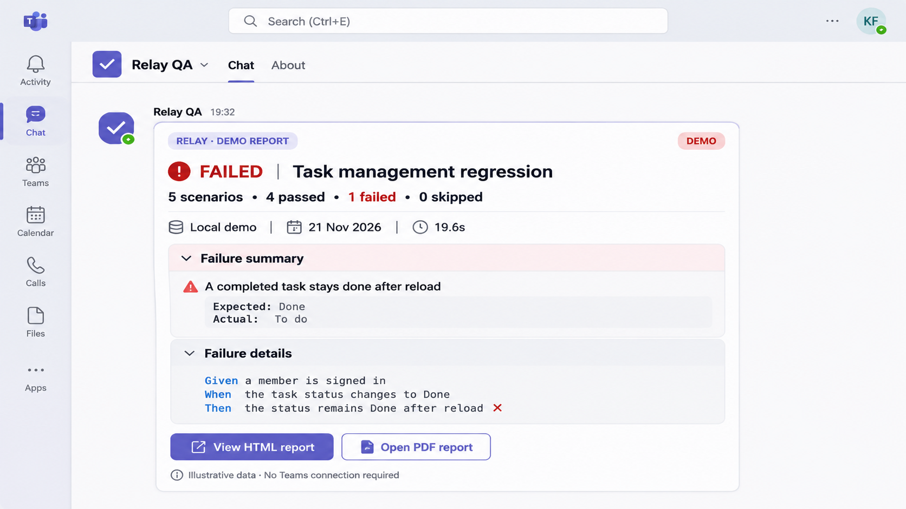
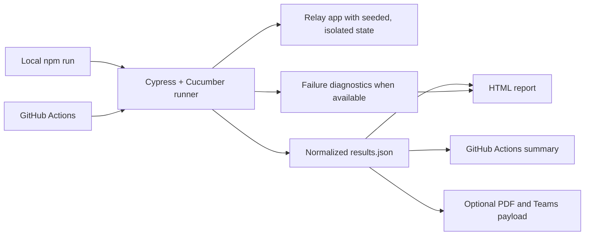
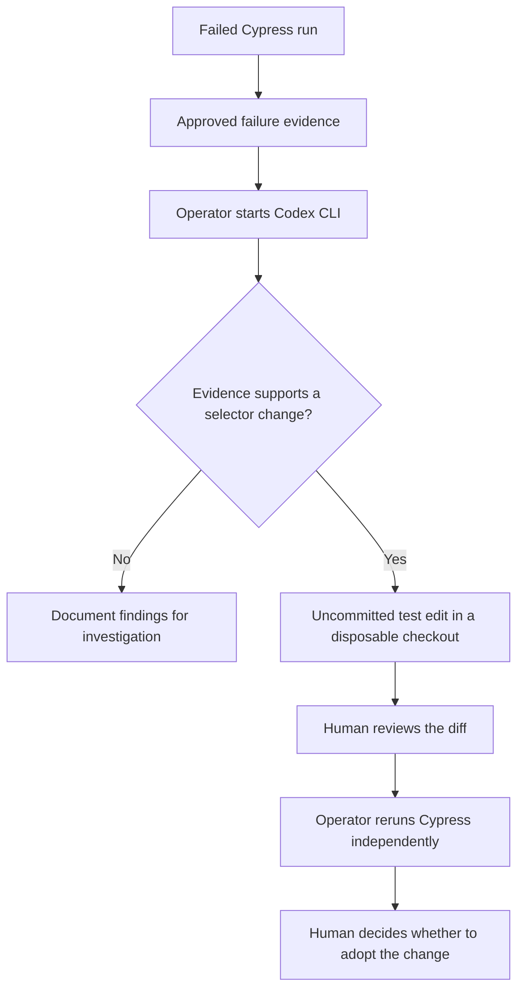

# Relay | Quality Engineering Accelerator

**Behaviour-driven Cypress automation, CI reporting, and experimental AI-assisted test maintenance.**

**Kate Frishman · Quality Engineering Consultant**

Relay is a synthetic project and task management app that shows how a SaaS team
can check critical journeys on every change and make regression failures easier
for engineers and delivery stakeholders to investigate. It is a portfolio
reference implementation built around repeatable test data and inspectable evidence.

[Browse Gherkin scenarios](cypress/e2e/features) ·
[View the CI workflow](.github/workflows/ci.yml) ·
[Reproduce the Codex demo](docs/AI_MAINTENANCE.md#coding-agent-proof-of-concept) ·
[Connect on LinkedIn](https://www.linkedin.com/in/kate-frishman/)

## See a regression through a stakeholder’s eyes



*Illustrative UI mockup using synthetic Relay failure data. The layout, controls,
and timing shown are illustrative. Live Microsoft Teams delivery has not been
verified. The actual payload fixtures are available as [passing](examples/sample-passed.json)
and [failing](examples/sample-failed.json) Adaptive Card JSON.*

In the [application-defect demo](docs/AI_MAINTENANCE.md#reproduce-the-three-cases),
a task marked **Done** returns to **To do** after reload. The Gherkin scenario
catches the regression at the persistence check, and the run archive preserves the
failed step and available diagnostic evidence for investigation.

| Capability | What you can review | Status |
| --- | --- | --- |
| [Core QA Automation](#1-core-qa-automation) | Cypress and Cucumber coverage, isolated test data, GitHub Actions, and readable reports | Implemented and tested locally and in CI |
| [AI-Assisted Test Maintenance](#2-ai-assisted-test-maintenance) | Codex CLI investigation, an uncommitted selector proposal, and a separate Cypress rerun | Experimental local proof of concept with human review |

## 1. Core QA Automation

**Implemented and locally validated.** The core suite runs independently of
AI tools, GitHub credentials, and paid reporting services.

| Capability | What it demonstrates |
| --- | --- |
| Cypress, TypeScript, and Cucumber | 14 [Gherkin scenarios](cypress/e2e/features) cover authentication, permissions, collaboration, task persistence, validation, and filtering. |
| Test data management | Cypress runs the real Node HTTP app on an ephemeral loopback port. Each scenario starts with fresh seeded data and sessions. API setup uses the same service as the browser. |
| Node integration tests | Exercise authentication, access control, persistence, and the reporting pipeline without launching a browser. |
| CI and reporting | [GitHub Actions](.github/workflows/ci.yml) runs lint, type checks, Node tests, and Cypress on pushes and pull requests. It uploads run artifacts even after a Cypress failure and preserves the test exit code. |
| Optional notifications and storage | PDF export is locally validated. Teams card generation and SharePoint upload logic are covered with mocks. Live delivery requires separate tenant configuration and validation. |

### Architecture

- **System under test:** A Node.js HTTP API, plain JavaScript browser UI, and optional
  local JSON persistence. [Seed data](seed.js) includes example users, projects, and tasks.
- **Automation:** [Feature files](cypress/e2e/features) describe behavior.
  [Step definitions](cypress/e2e/step_definitions) use shared
  [Cypress helpers](cypress/pages) and [API setup](cypress/api).
  [Cypress configuration](cypress.config.ts) owns the test server and resets data.
- **Reporting:** [The runner](quality/run.mjs) normalizes Cucumber output into
  `results.json`. The HTML report, CI summary, optional PDF, and Teams card
  use that same data.



### Run the checks

Use Node.js 24 from [`.nvmrc`](.nvmrc). If you use nvm, run
`nvm install && nvm use` first.

```sh
npm ci
npm run lint
npm run typecheck
npm test
npm run test:e2e
```

Run a single feature with
`npm run test:e2e -- --spec cypress/e2e/features/collaboration.feature`.
Use `npx cypress open` to debug interactively.

To explore Relay manually, run `npm start` and open
[http://127.0.0.1:3000](http://127.0.0.1:3000). The sign-in form can fill the
three **public synthetic demo accounts**. Please use them only in a local or
isolated environment. Data for a manually started app lives in `.data/workspace.json`.
Set `RELAY_DATA_FILE` to use an independent data file.

**Business demo:** Sign in as Sam Rivera, share **Website refresh** with Jordan
Lee, and assign Jordan a task. Sign in as Jordan to show the shared workspace.
Then remove Jordan as Sam and verify that access is revoked and the task is
unassigned. The [collaboration feature](cypress/e2e/features/collaboration.feature)
reproduces this workflow automatically.

### Read the results

Open `reports/<UTC date>/<run ID>/index.html`. A passing run contains the HTML
report and `results.json`. A failed or incomplete run adds `diagnostics/` with
the available Cypress log, failed-screen screenshots, DOM selectors, and concise
failure findings. GitHub Actions writes a job summary and uploads the same archive.

| Setting | Default and effect |
| --- | --- |
| `RELAY_REPORT_PDF=1` | Off. Adds a PDF export and enables PDF upload when SharePoint is configured. |
| `RELAY_REPORT_VERBOSE=1` | Off. Retains raw Cucumber JSON and available diagnostics, including logs on passing runs. |
| `RELAY_ARCHIVE_TEAMS_CARD=1` | Off. Saves the card JSON for inspection. |
| `RELAY_ARTIFACT_RETENTION_DAYS` | Defaults to 30. Accepts 1–90 days in GitHub Actions, subject to the repository or organization limit. |

Set these as local environment variables or, for CI, as GitHub Actions repository
variables. Compare runs with
`npm run report:compare -- <first/results.json> <second/results.json>`.
Generated archives, raw logs, and local app data are ignored by Git. Use only
synthetic data in public workflow runs and review artifact contents before sharing.

<details>
<summary>Optional Teams and SharePoint configuration</summary>

Set `TEAMS_WEBHOOK_URL` as a GitHub Actions secret for a Teams Workflows webhook.
Relay publishes from trusted `main` runs. The card links to the GitHub artifact
by default or to an HTTPS PDF configured through `REPORT_PDF_URL`. Use the
[passing](examples/sample-passed.json) and [failing](examples/sample-failed.json)
sample cards to preview locally without a webhook. See
[Teams Workflows webhook setup](https://learn.microsoft.com/microsoftteams/platform/webhooks-and-connectors/how-to/add-incoming-webhook).

For SharePoint, enable `RELAY_REPORT_PDF=1` and set repository variables
`SP_TENANT_ID`, `SP_CLIENT_ID`, and `SP_DRIVE_ID`, plus the
`SP_CLIENT_SECRET` secret. Grant the Entra application Graph
`Sites.Selected` permissions and write access to the target site. Existing
SharePoint permissions govern who can open the uploaded report. See
[Microsoft Graph selected permissions](https://learn.microsoft.com/en-us/graph/permissions-selected-overview).

</details>

## 2. AI-Assisted Test Maintenance

**Experimental, locally validated with an actual Codex CLI run.** An operator
starts the investigation. Relay summarizes the failed Gherkin steps, Cypress error,
and DOM selectors from the same report archive. Codex inspects the relevant source
in a disposable checkout and can leave a targeted, uncommitted test change.
Review the diff, then rerun Cypress separately before deciding whether to adopt it.

The demonstrated selector change was outside the deterministic repair policy.
Codex identified the renamed status-filter selector and proposed one locator edit.
An independent rerun passed all 14 scenarios. A separate read-only investigation
identified an application persistence defect and left the test expectations intact.



| Workflow | Status |
| --- | --- |
| [Codex handoff and human review](docs/AI_MAINTENANCE.md#coding-agent-proof-of-concept) | Experimental. Requires a signed-in Codex CLI and an approved run archive. Verified locally on synthetic fixtures. |
| [Deterministic failure demonstrations](docs/AI_MAINTENANCE.md#reproduce-the-three-cases) | Implemented and locally validated. Demonstrates an application defect, a known selector change, and an environment failure. |
| [Digest-based patch approval](docs/AI_MAINTENANCE.md#inspect-and-approve-a-proposal) | Implemented for a single allowlisted deterministic selector correction. Separate from the Codex experiment. |
| [Ollama nomination](docs/AI_MAINTENANCE.md#optional-model-nomination) | Optional adapter. Live model inference through this adapter has not been validated. |

To generate the experimental failure:

```sh
node quality/maintenance/demo.mjs agent-selector
```

Follow the [reproduction, scope, and validation guide](docs/AI_MAINTENANCE.md)
for the remaining steps. The standard CI run uses offline diagnostics. Codex
has no automatic PR or merge workflow. Use trusted, synthetic evidence and
review the generated prompt before sending it to a model provider.

## Consulting services

**QA Automation Launch · from £4,950**

Establish Cypress and Cucumber coverage for business-critical journeys, with
repeatable test data, CI checks, readable reports, and a team handover.
The indicative scope is 20–30 standard-complexity scenarios over 2–3 weeks,
subject to discovery, system access, and project readiness.

**AI-Assisted Test Maintenance Pilot · from £2,500**

Trial coding-agent support for failure investigation and reviewable test-change
proposals in an existing automation workflow. The indicative duration is 1–2
weeks, depending on the environment and approvals. The pilot includes human
review and independent test validation.

Pricing, scope, and timing are indicative. Discovery confirms deliverables,
access, AI-provider approvals, and any recurring model costs.

[Discuss a project on LinkedIn](https://www.linkedin.com/in/kate-frishman/)
